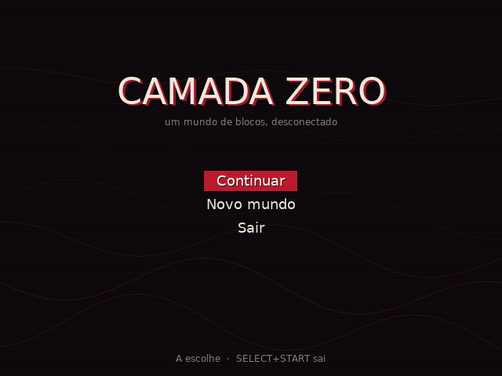
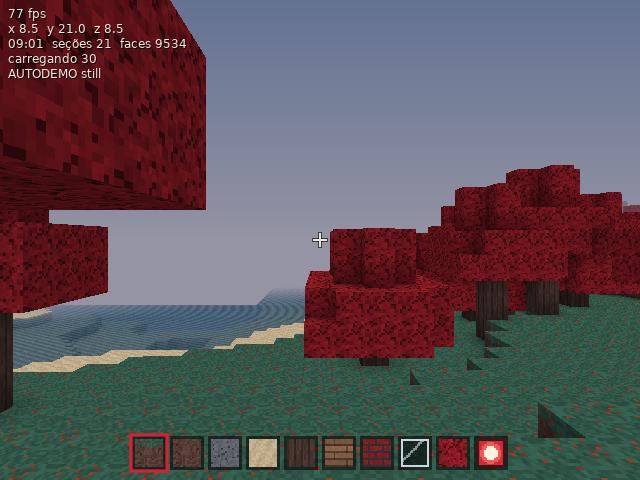
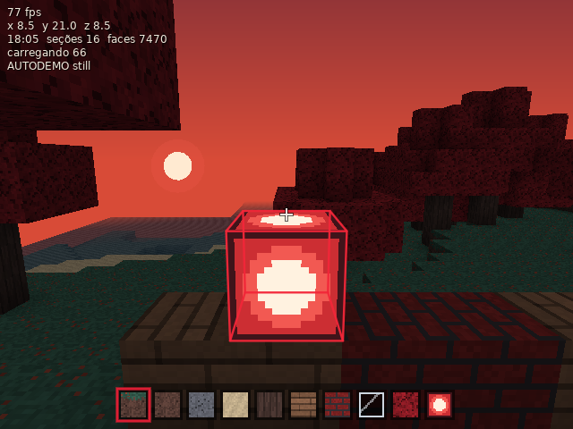
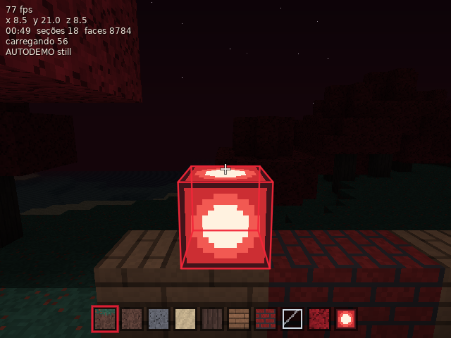
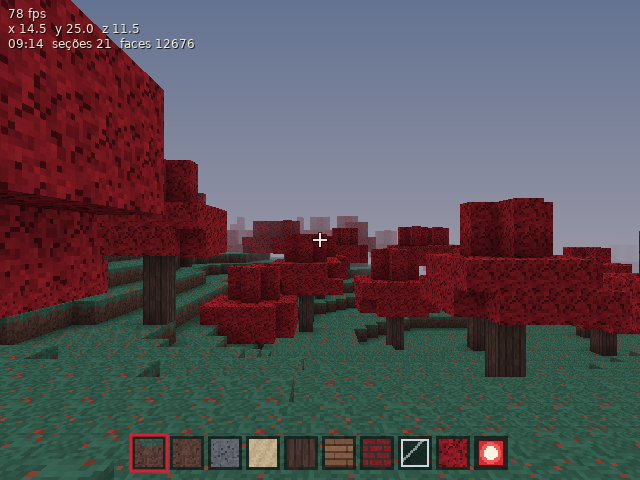
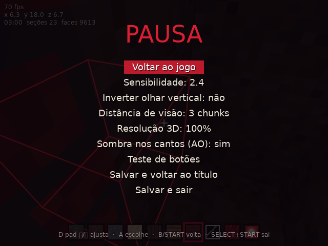
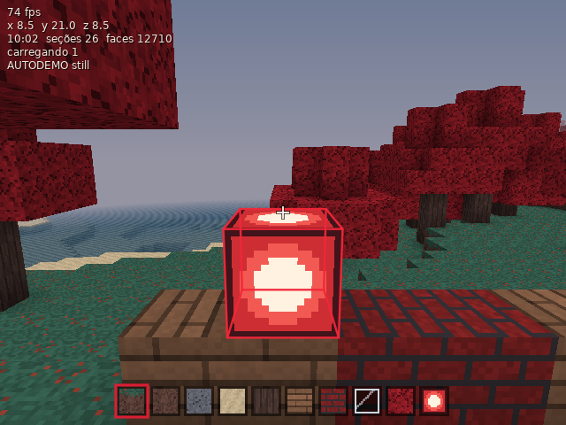
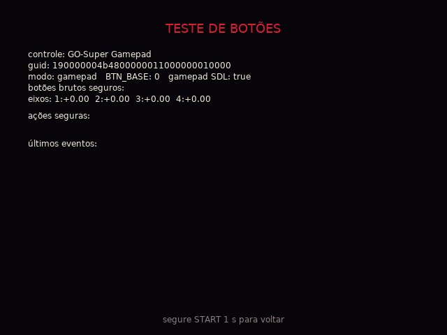

# Camada Zero

Sandbox de blocos em primeira pessoa, original, feito para o R36S (ArkOS,
LÖVE 11.5 do PortMaster, 640×480, Mali-G31). Mundo gerado por ruído, dez tipos
de bloco na hotbar, árvores, água, ciclo de dia/noite, quebrar/colocar com
mira, hotbar, pausa, salvamento automático e manual.

Tudo que aparece na tela e no áudio é gerado por código: o atlas de texturas
(128×32, 16×16 por tile) é pintado em Lua no `load` e os sons são sintetizados
em `sfx.lua`. Nenhum asset, nome ou textura de outro jogo é usado.

## Capturas (no R36S de verdade)

Capturas do framebuffer do aparelho, 640×480, durante o autodemo. Não são mockups.

|  |  |
|---|---|
|  |  |
| Tela de título | Mundo de dia, com a hotbar |
|  |  |
| Pôr do sol, com a lâmpada acesa | Noite: estrelas e luz da mão |
|  |  |
| Mundo novo: spawn em clareira | Pausa com os ajustes |
|  |  |
| Depois de sair e reabrir: os blocos continuam lá | Teste de botões do próprio jogo |

## Controles (gamepad)

| Entrada | Ação |
|---|---|
| Analógico esquerdo | Andar |
| Analógico direito | Olhar (sensibilidade e inversão no menu de pausa) |
| A | Pular (na água, sobe) |
| B | Correr |
| R1 / R2 | Quebrar bloco (segurar repete) |
| L1 / L2 | Colocar bloco (segurar repete) |
| X / Y | Bloco anterior / próximo |
| D-pad ← / → | Bloco anterior / próximo |
| D-pad ↑ | Liga/desliga o HUD |
| START | Pausa |
| SELECT + START | Salva e sai para o menu |
| D-pad / analógico no menu | Navegar; A confirma; B volta |

No PC (depuração): WASD anda, I/J/K/L olha, espaço pula, Shift corre,
X quebra, C coloca, Q/E trocam bloco, setas trocam bloco (←/→) e ligam o HUD
(↑), Enter/Esc pausa, Backspace é SELECT, F12 tira screenshot do LÖVE.

## Mapeamento de botões: o que foi provado

O `es_input.cfg` deste aparelho usa a numeração do joydev (A=1, B=0, ...), mas
o LÖVE/SDL não usa essa tabela: ele numera na ordem dos códigos evdev. Em vez de
confiar na tabela, injetei eventos no `/dev/input/event1` (gamepad real) e li o
que o jogo recebeu (arquivo `input.log` na pasta de save). Resultado medido:

| evdev injetado | SDL gamepad | botão bruto do LÖVE |
|---|---|---|
| 304 | `a` | 1 |
| 305 | `b` | 2 |
| 307 | `x` | 3 |
| 308 | `y` | 4 |
| 310 | `leftshoulder` | 5 |
| 311 | `rightshoulder` | 6 |
| 312 | `triggerleft` (eixo) | 7 |
| 313 | `triggerright` (eixo) | 8 |
| 545 (D-pad ↓) | `dpdown` | 10 |
| 704 (SELECT) | *(não mapeado)* | 13 |
| 705 (START) | *(não mapeado)* | 14 |

Conclusões:

- O caminho preferido é a **API de gamepad do SDL** (`gamepadpressed` com
  `"a"`, `"leftshoulder"`, `"dpdown"`...). O controle é reconhecido
  (`gamepad=true`, GUID `190000004b48000000110000000010000`).
- O SDL **não mapeia SELECT nem START** neste controle. Por isso o jogo usa o
  caminho bruto só para esses dois (e L3), mesmo no modo gamepad.
- A tabela bruta do jogo está em numeração do LÖVE (1-based), com
  `BTN_BASE = 0`: `a=1, b=2, x=3, y=4, l1=5, r1=6, l2=7, r2=8, up=9, down=10,
  left=11, right=12, select=13, start=14, l3=15`. Se algum dia o LÖVE mudar a
  base, basta trocar `BTN_BASE` em `input.lua`; o overlay "Teste de botões"
  (menu de pausa) mostra modo, base e os últimos eventos.

## O que o jogo tem

- Primeira pessoa: andar, olhar, pular, correr, gravidade, colisão AABB por
  eixo (não atravessa parede, não cai pelo chão) e natação lenta na água.
- Mundo 16×16 chunks, 48 de altura, ruído de valor determinístico por seed;
  relva/terra/pedra/areia/água, árvores de tronco e folhas carmim.
- 12 tipos de bloco no total; 10 na hotbar: relva, terra, pedra, areia, tronco,
  tábuas, tijolo, vidro, folhas e lâmpada (a lâmpada é emissiva).
- Mira no centro + raycast DDA (alcance 5), contorno do bloco mirado,
  quebrar/colocar, sem colocar dentro do jogador.
- Hotbar com troca por X/Y e pelo D-pad; nome do bloco aparece ao trocar.
- Salvar/carregar em `mundo.txt` (seed, posição, hora, slot e só as alterações
  do jogador), automático a cada 60 s, ao sair e ao voltar ao título.
- Ciclo dia/noite de 10 min: céu, sol, lua, estrelas, névoa e luz da mão à
  noite.
- Menu inicial (Continuar/Novo mundo/Sair), pausa com START e ajustes
  (sensibilidade, inverter eixo Y, distância 1–5 chunks, resolução 3D 50/75/100%,
  AO, teste de botões, salvar e sair).
- Sons sintetizados para quebrar, colocar e navegar no menu.
- Modo autodemo por arquivo-flag (`autodemo.flag`), usado nos testes.

Não tem: cavernas, crafting, inventário, mobs, multiplayer, água corrente,
gravidade de areia, iluminação por tocha (só a lâmpada emissiva e a luz da mão).

## Arquitetura

```
main.lua        estados (título/carregando/jogo/pausa/teste), HUD, menus, autodemo
conf.lua        janela 640×480, depth 24, identidade "camadazero"
blocks.lua      tipos de bloco + atlas procedural (pintores por tile)
gen.lua         geração por ruído (roda no worker; sem love.math)
worldcfg.lua    constantes compartilhadas (16/48/16)
world.lua       chunks em ffi uint8, edições do jogador, save/load
mesher.lua      malha por seção: faces expostas, AO por vértice, 12 bytes/vértice
net.lua         fila principal -> worker (geração e malha)
meshworker.lua  thread: gera chunks e monta malhas (JIT desligado)
iolog.lua/iowriter.lua  gravação em thread própria (mundo, logs)
render.lua      shader GLSL ES, matrizes, frustum, céu, névoa, contorno
player.lua      física AABB e raycast DDA
input.lua       gamepad SDL + fallback bruto + teclado, log de eventos
sfx.lua         sons gerados por código
```

Detalhes que importam neste hardware:

- **GPU**: um único shader para opacos e outro (mesmo código, `#define CUTOUT`)
  para vidro/água. Vértices de 12 bytes (posição em bytes ×15, tile/canto e luz),
  decodificados no vertex shader; profundidade no canvas da tela; faces
  traseiras descartadas; seções fora do frustum nem são desenhadas; água
  ordenada de trás para frente e desenhada sem cull.
- **Chunks**: 16×16×48, divididos em 3 seções de 16 de altura. Cada seção tem
  malha opaca e transparente; só é remontada quando um bloco muda. Seções acima
  do ponto mais alto do terreno nem entram na fila (flag `empty`).
- **Thread**: geração e malha rodam num worker. Edições vão por um canal
  urgente (fura a fila), então o bloco quebra/coloca na hora e a malha chega
  ~60–130 ms depois. Em operação normal o jogo não monta malha na thread que
  desenha (há um caminho síncrono só como reserva, se o worker não subir).
- **JIT**: este runtime entrega o LuaJIT com JIT desligado. Ligar (`jit.on`)
  causou segfault intermitente (3 quedas em testes; 175 s estável com JIT
  desligado). O jogo não liga o JIT e o worker chama `jit.off()`.
- **I/O**: `love.filesystem.write/append` bloqueava a thread principal por até
  ~800 ms neste cartão (salvar 150 bytes levava ~475 ms). Mundo e logs são
  gravados por uma thread com `io` puro; no quit o jogo espera a fila esvaziar.

## Instalação no aparelho

```bash
sudo mkdir -p /mnt/jogos/camadazero
sudo cp *.lua *.sh /mnt/jogos/camadazero/
sudo chmod -R a+rwx /mnt/jogos/camadazero
sudo install -m 755 camadazero-console.sh /usr/local/bin/camadazero-console.sh
sudo install -m 755 CamadaZero.sh /roms/ports/CamadaZero.sh
# entrada em /roms/ports/gamelist.xml (backup em gamelist.xml.bak-camadazero)
```

O launcher segue o padrão do `voxel-console.sh`: checa jogo aberto, cria
`/tmp/r36s-console.lock` com `trap` de saída, para o EmulationStation, roda o
LÖVE como `ark` e sobe o menu de volta (esperando o ES ficar ativo antes de
soltar a trava).

## Desempenho medido no aparelho

Condições: 640×480, distância 3 chunks, resolução 3D 100%, AO ligado, autodemo
andando/quebrando/colocando, JIT desligado, worker ativo.

| Medição | Resultado |
|---|---|
| 180 s sem capturas externas | mín 70,6 / média 76,9 / máx 78,1 fps; pior quadro 92 ms; 1 quadro >40 ms em 178 amostras |
| 180 s com 4 capturas drmcap | média 76,7 fps; mín 31,9 (congelamento durante a leitura do framebuffer); 7 quadros >40 ms |
| RSS do `love.aarch64` | 103,6 MB no início → 107,4 MB no fim (estável) |
| Carga inicial | ~2,5–3 s até entrar no jogo (3×3 chunks); o resto do raio preenche em segundo plano |
| CPU | ~53–80% de um núcleo (média do `ps`), memória total do sistema ~160 MB usados |

Comparações do mesmo dia, úteis para o histórico:

- Com JIT ligado: 3 segfaults (inclusive em 3 s de jogo); descartado.
- Com `love.filesystem` síncrono: salvar 150 bytes = ~475 ms, logs até ~800 ms
  e congelamentos de ~1 s; resolvido com a thread de I/O.
- Antes do worker de malha: 50–100 ms por seção e travadas de 100–900 ms ao
  gerar chunks; depois: sem travadas acima de 92 ms no teste de 3 min.

## Testes e provas

Capturas reais do framebuffer DRM (`drmcap.py`), todas com 1.228.800 bytes
(640×480×4) conferidos. As principais estão em [`screenshots/`](screenshots/):

- [`titulo.png`](screenshots/titulo.png) — tela de título.
- [`mundo-dia.png`](screenshots/mundo-dia.png) — mundo de dia, com a hotbar.
- [`por-do-sol.png`](screenshots/por-do-sol.png) e [`noite.png`](screenshots/noite.png) — céu, estrelas e luz da mão.
- [`save-carregado.png`](screenshots/save-carregado.png) — mesma cena depois de sair e reabrir: save/load.
- [`pausa.png`](screenshots/pausa.png) — menu de pausa com os ajustes.
- [`teste-de-botoes.png`](screenshots/teste-de-botoes.png) — overlay com modo, base e GUID do controle.
- [`novo-mundo.png`](screenshots/novo-mundo.png) — mundo novo, spawn em clareira.

Testes funcionais:

1. **Controles por injeção**: eventos escritos em `/dev/input/event1`;
   `input.log` registrou `gamepad a`, `gamepad leftshoulder`, `gamepad
   triggerleft`, `gamepad dpdown`, `bruto botao=13 -> select`, `bruto botao=14
   -> start`. O combo SELECT+START encerrou o jogo de verdade.
2. **Atalho**: `/roms/ports/CamadaZero.sh` (via `systemd-run`) subiu o jogo com
   o ES parado (`ES durante: inactive`), `/tmp/r36s-console.lock` presente,
   e ao sair o ES voltou (`active`) e a trava sumiu.
3. **Save/load**: o modo `stamp` alterou 9 blocos; `mundo.txt` ficou com 158
   bytes e 9 entradas; ao reabrir, a captura mostrou os mesmos blocos e a
   lâmpada acesa na mesma posição.
4. **Pausa**: START abriu o menu, START de novo voltou ao jogo.
5. **3 minutos**: 180 s de autodemo, 43 quebras e 39 colocações, sem erro no
   `error.log` e sem crash.

## Limites conhecidos

- O raio de visão padrão é 3 chunks; ao andar rápido para área nova, o mundo
  aparece em segundo plano (o contador "carregando" no HUD mostra a fila).
- Um único worker: a fila pode ficar em ~1 item no anel externo, que só é
  montado quando o jogador se aproxima.
- Não há mouse look no PC (só teclado) nem suporte a dois controles.
- A água é um bloco visual não sólido; não há propagação.
- O `fps` do HUD é o do LÖVE (vsync ~78 Hz neste painel).
